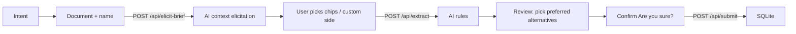

# Playbook from Agreement (Val Town)

Part of [open-legal-artifacts](../../README.md). Turn a pasted or uploaded
agreement into an ACC-style **contracts playbook draft**:
preferred positions, ordered fallbacks, and deal-breakers — then **confirm**
before save.

[Open the live demo](https://arthrod--cdf728ae-d937-11f1-a239-1607ee4eb77e.web.val.run/)

Inspired by:

- **potion_deploy** playbook creator flow (`upload → process → review → confirm → saved`)
- **legal-intake** val patterns (structured JSON schema, free `gpt-5-nano`, confirm gate, SQLite)
- **ACC 2012** “A Play-by-Play Guide to Creating a Contracts Playbook”
  (red/yellow/green, must/nice/can’t-haves, fallbacks, audience, escalation)

## Why this shape

Customers do not all want the same thing when they “send a document”:

| Intent | What we do |
|---|---|
| **Full playbook** | Material clauses → preferred + fallbacks + avoid |
| **Format only** | Topic skeleton + short positions (breadth over depth) |
| **One clause** | Deep dive on `focus` only |
| **Counter-party paper** | Their form → our pushbacks / redlines |
| **Unsure** | AI infers intent + still returns a usable draft |

That triage keeps the free model cheap and the user from drowning in noise.

## Flow



1. **Intent** — full / format / single clause / counter paper / unsure (gates later fields)  
2. **Document** — name + paste text, or upload `.docx` / `.pdf` / `.txt` / `.md`
   (parsed **in your browser** — files are never uploaded server-side)  
3. **AI elicit** — model proposes `our_side` (free-form + chips), audience,
   contract type, focus/granularity **only when intent needs them**  
4. **Extract** — `gpt-5-nano` → ACC-style rules  
5. **Review** — elicitation chips for preferred / risk / escalate; show “Your edits”  
6. **Confirm** — “Are you sure?” → save  

`our_side` is **never** a closed enum — type guarantor, franchisee, JV partner, etc.

## Rule shape (ACC row)

```
Topic | Preferred | Alternates (ordered) | Avoid | Risk (RYG) | Escalate | Sample language
```

Plus `raise_mode` (proactive vs reactive), `source_quote`, `rationale`, `confidence`.

## Files

| Path | Role |
|---|---|
| `backend/index.http.tsx` | Hono: static + `/api/elicit-brief` + `/api/extract` + `/api/review-counter` + `/api/submit` + `/api/help` + `/api/playbooks*` |
| `backend/llm.ts` | `std/openai` (`gpt-5-nano`): elicit + extract + review-counter + help |
| `backend/db.ts` | Val-scoped SQLite `playbooks_v2` (family lineage + versions) |
| `shared/types.ts` | Shared types (browser + Deno) |
| `shared/catalog.ts` | Intent catalogs, `EXTRACT_SCHEMA`, prompts, repair |
| `frontend/index.tsx` | Multi-step UI |
| `frontend/index.html` | Twind + catch |

## API

| Method | Path | Body / params |
|---|---|---|
| `POST` | `/api/elicit-brief` | `{ brief, document_text }` → AI proposes context fields (our_side, audience, …) with alternatives before extract |
| `POST` | `/api/extract` | `{ brief, document_text, source_filename? }` |
| `POST` | `/api/review-counter` | `{ rules, counterparty_text, party_vocabulary? }` → clause-by-clause redline of the other side's draft against a playbook (no DB write) |
| `POST` | `/api/submit` | `{ playbook: PlaybookRecord, family_id? }` |
| `POST` | `/api/help` | `{ brief?, question }` |
| `GET` | `/api/playbooks` | list (latest per family); `?vault=exclude` hides private-vault ones |
| `GET` | `/api/playbooks/family/:familyId` | version history for a family, newest first, with a clause-level diff against the prior version |
| `GET` | `/api/playbooks/:id` | full payload |

## Run locally

Requirements: Deno 2.

```sh
deno task test   # test task (env stubbed for offline mode)
```

The backend entry point is `backend/index.http.tsx` (Hono). A standalone local
Deno server is **not** equivalent to the hosted Val Town environment — see
[docs/val-town-portability.md](../../docs/val-town-portability.md) for the
remix/clone recipe and the runtime couplings (`std/openai`, val-scoped SQLite,
the 80 KB/file cap).

## Fixtures

`fixtures/` holds fictional demo data exported from a walkthrough of the live
demo: `sample.docx` (a sample agreement) and `sample.md` (the playbook draft
exported from it). Use these — never real agreements — when trying the extract
and counterparty-review flows.

## Deploy

```sh
cd playbook-from-doc
vt create playbook-from-doc   # once
vt push                       # or: vt watch
```

Uses free Val Town OpenAI — **no API key**. Model: `gpt-5-nano`.

## Live

- demo:     <https://arthrod--cdf728ae-d937-11f1-a239-1607ee4eb77e.web.val.run/>
- code:     <https://www.val.town/x/arthrod/playbook-from-doc/code/>
- endpoint (unlisted): <https://arthrod--7569f630800e11f1ad4a1607ee4eb77e.web.val.run/>

## Local notes

- Session drafts live in `localStorage` (`playbook-from-doc.session.v1`).
- Long documents are truncated (~14k chars) before the model call.
- Reading stored playbooks (`GET /api/playbooks`, `/api/playbooks/:id`, `/api/playbooks/family/:familyId`) needs `Authorization: Bearer $ADMIN_TOKEN`. With `ADMIN_TOKEN` unset those routes answer 503 (fails closed); see `backend/auth.ts`.
- `.docx` and `.pdf` are parsed client-side (mammoth / pdfjs, dynamically imported); the file never leaves the browser. Pasting text always works as the fallback.

## Lineage

`elicitation` (an MCP `elicitation/create` form lab, March 2026; no model, no storage) →
`legal-intake` (first model-backed intake, for in-house requests; retired) →
`playbook-from-doc` (the engine with tests, redaction and versioning) →
`client-intake` (the same engine, for law-firm intake). Stored records on all three model-backed
vals are readable only with `ADMIN_TOKEN` (`backend/auth.ts`).
